# 차량 서스펜션 동역학 모델링 및 FMU 개발

> **VEHICLE DYNAMICS · CO-SIMULATION FMU**
> 서스펜션 기구학 해석 → FSM(Functional Suspension Model) 동역학 모델 → C 코어 이식 → FMI 2.0 Co-Simulation FMU 패키징까지의 전 과정을 하나로 정리한 문서입니다.

## 전체 흐름

| 단계 | 내용 | 주요 결과물 | 원본 자료 |
| --- | --- | --- | --- |
| 1 | 프로젝트 개요 | 목적 · 이식 경로 · 적용 대상 | 차량_서스펜션_동역학_FMU_개발보고서 |
| 2 | 서스펜션 기구학 해석 | 하드 포인트 → 구속방정식·Jacobian → 휠 x, y, z / camber, spin, toe 곡선 | suspension_kinematics, suspension_kinematics_ref |
| 3 | FSM 동역학 모델 (MATLAB) | Quarter car → Full car(7자유도) → step steering · 코너링 compliance 해석 | FSM_차량동역학_4 |
| 4 | C 코어 이식 | fsm_step() 1ms 고정 스텝 코어 | 차량_서스펜션_동역학_FMU_개발보고서 |
| 5 | FMI 2.0 FMU 패키징 | 5입력·35출력 Co-Simulation FMU | 차량_서스펜션_동역학_FMU_개발보고서 |
| 6 | 개발 이슈 · 검증 · 결론 | 수치 안정화, 테스트 시나리오, 향후 과제 | 차량_서스펜션_동역학_FMU_개발보고서, FSM_차량동역학_4 |

---

# 1. 프로젝트 개요

본 문서는 차량 4륜 독립 서스펜션 및 조향/횡방향 거동을 재현하는 멀티바디 동역학 코어(FSM Suspension Core)를 FMI 2.0 Co-Simulation FMU 형태로 패키징한 결과물을 정리한 보고서입니다. 원본은 MATLAB Level-2 S-Function으로 개발되었으며, 반복적인 검증·튜닝 과정을 거쳐 C 언어 기반 고정 스텝(1ms) 모델로 이식되었고, 최종적으로 FMI2 표준 인터페이스로 감싸져 Simulink 등 외부 co-simulation 환경(Hills)에서 재사용 가능한 형태로 완성되었습니다.

| 구분 | 내용 |
| --- | --- |
| 목적 | 조향각·차속 입력에 대한 4륜 서스펜션 스트로크, 얼라인먼트, 차체 요·횡슬립 거동을 실시간 재현 |
| 이식 경로 | MATLAB S-Function(오프라인 배치) → one-step C 코어 → FMI2 fmi2DoStep 래핑 |
| 적용 대상 | Hills 차량동역학 시뮬레이션의 서스펜션/조향 서브모듈로 co-simulation 연동 |

> **5** 입력 변수 · **35** 출력 변수 · **1 ms** 고정 스텝(FSM_DT)
> 소스: fmi2Functions / fsm_suspension_core_from_m_original_strict / FSM S-Function 개발 로그

> 🔗 **다음 장과의 연결** — 이 FMU의 코어는 전륜 휠의 위치·자세를 서스펜션 스트로크의 다항식(커플러 커브)으로 계산합니다. 2장은 그 바탕이 되는 서스펜션 기구학 해석(하드 포인트 → 구속방정식 → 휠 자세 곡선)입니다.

---

# 2. 서스펜션 기구학 해석

Double wishbone 서스펜션(Front Right)의 하드 포인트로부터 UCA(Upper control arm) 국부좌표계, 구속방정식, Jacobian을 유도하고 휠의 x, y, z, camber, spin, toe 변화를 계산합니다. 같은 절차를 두 가지 하드 포인트 세트에 적용했습니다.

- **기본** : suspension_kinematics
- **ref** : suspension_kinematics_ref

## 2-1. 하드 포인트 (Front Right)

**기본**

| 부품 | 위치 | x | y | z | 좌표 |
| --- | --- | --- | --- | --- | --- |
| Wheel center | | 267 | -760 | 330 | G |
| Upper control arm | Front | 367 | -450 | 555 | L |
| Upper control arm | Outer | 307 | -675 | 555 | C |
| Upper control arm | Rear | 517 | -490 | 560 | M |
| Lower control arm | Front | 67 | -400 | 180 | N |
| Lower control arm | Outer | 267 | -750 | 130 | D |
| Lower control arm | Rear | 467 | -450 | 185 | O |
| Tie rod | Inner | 467 | -400 | 330 | F |
| Tie rod | Outer | 417 | -750 | 330 | E |

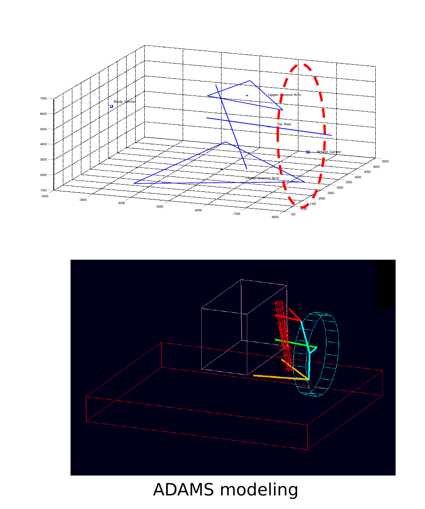

**ref**

| 부품 | 위치 | x | y | z | 좌표 |
| --- | --- | --- | --- | --- | --- |
| Wheel center | | 0 | 770 | 0 | G |
| Upper control arm | Front | -155 | 492.5 | 397 | L |
| Upper control arm | Outer | 24 | 664.5 | 395 | C |
| Upper control arm | Rear | 60 | 492.5 | 385 | M |
| Lower control arm | Front | 20 | 353.5 | -77 | N |
| Lower control arm | Outer | -5.5 | 736.7 | -90 | D |
| Lower control arm | Rear | 347 | 367.5 | -73 | O |
| Tie rod | Inner | 169 | 418 | 40 | F |
| Tie rod | Outer | 135 | 703.5 | 39.5 | E |

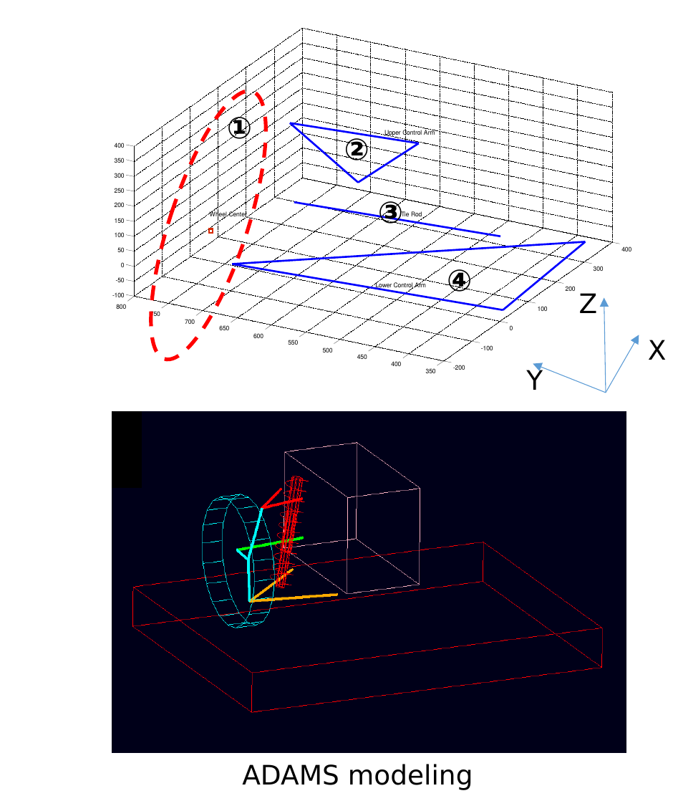

## 2-2. ② UCA — 점 C에서 LM에 내린 수선의 발 A

UCA는 L, M(차체 측)과 C(휠 측) 세 점으로 이루어진 삼각형이며, k2는 LM의 단위벡터입니다. 점 C에서 LM에 내린 수선의 발 A(xA, yA, zA)를 구합니다.

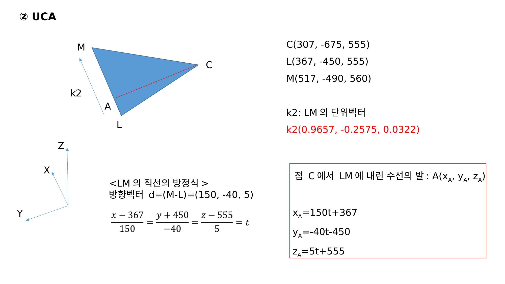

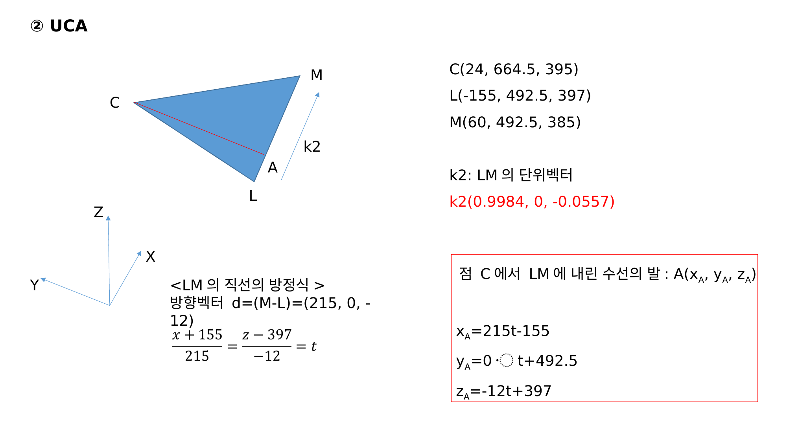

| 항목 | 기본 | ref |
| --- | --- | --- |
| C | (307, -675, 555) | (24, 664.5, 395) |
| L | (367, -450, 555) | (-155, 492.5, 397) |
| M | (517, -490, 560) | (60, 492.5, 385) |
| k2 (LM의 단위벡터) | (0.9657, -0.2575, 0.0322) | (0.9984, 0, -0.0557) |
| 방향벡터 d=(M-L) | (150, -40, 5) | (215, 0, -12) |

**LM의 직선의 방정식**

기본:

$$
\frac{x-367}{150} = \frac{y+450}{-40} = \frac{z-555}{5} = t
$$

$$
x_A = 150t+367, \qquad y_A = -40t-450, \qquad z_A = 5t+555
$$

ref:

$$
\frac{x+155}{215} = \frac{z-397}{-12} = t
$$

$$
x_A = 215t-155, \qquad y_A = 0 \cdot t+492.5, \qquad z_A = -12t+397
$$

**CA ⊥ LM 조건**

기본: CA=(xA-307, yA+675, zA-555)

$$
\begin{bmatrix} x_A-307, & y_A+675, & z_A-555 \end{bmatrix} * \begin{bmatrix} 150 \\ -40 \\ 5 \end{bmatrix}
$$

150\*(xA-307)-40\*(yA+675)+5\*(zA-555)=0

150\*(150t+367-307)-40\*(-40t-450+675)+5\*(5t+555-555)=0

ref: CA=(xA-24, yA-664.5, zA-395)

$$
\begin{bmatrix} x_A-24, & y_A-664.5, & z_A-395 \end{bmatrix} * \begin{bmatrix} 215 \\ 0 \\ -12 \end{bmatrix}
$$

215\*(xA-24)-12\*(zA-395)=0

215\*(215t-155-24)-12\*(-12t+397-395)=0

| 결과 | 기본 | ref |
| --- | --- | --- |
| t | 0 | 0.8305 |
| xA | 367 | 23.56 |
| yA | -450 | 492.5 |
| zA | 555 | 387.03 |

MATLAB 계산 (L, M 값만 세트별로 바꿔 사용)

```matlab
L=[367, -450, 555]        % ref: L=[-155, 492.5, 397]
M=[517, -490, 560]        % ref: M=[60, 492.5, 385]
d2=(M-L)
u2=d2'*([d2 L]-[zeros(3,1) C];
v2=roots(u2);   % ->t 값 계산

A=[d2 L]*[v2 1]';
```

## 2-3. UCA 국부좌표계와 A2 행렬

Upper control arm (Body2)는 다음과 같이 모델할 수 있다.

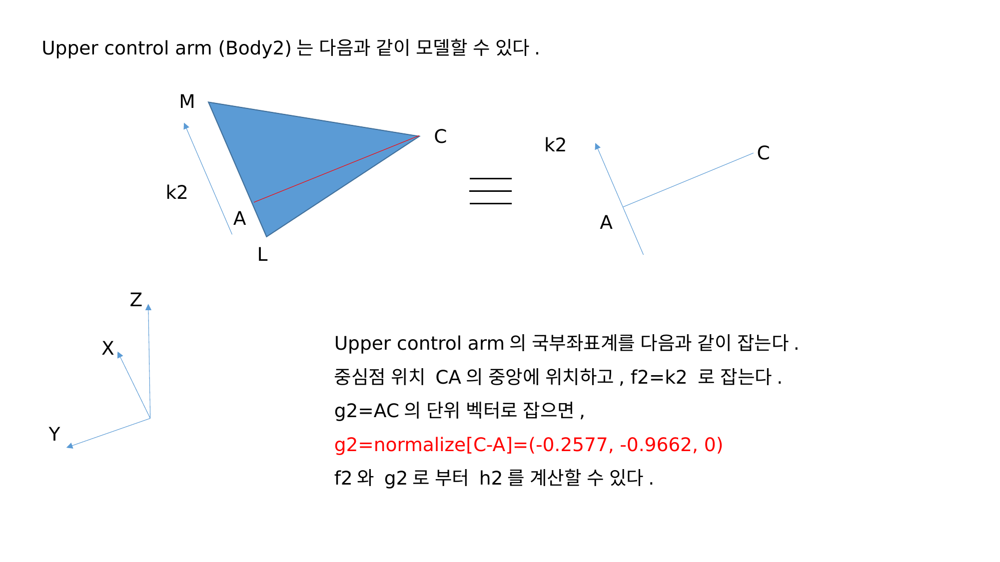

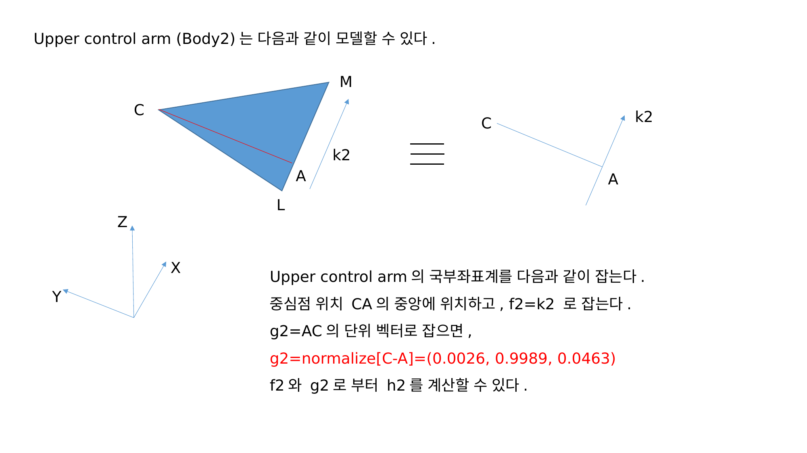

Upper control arm의 국부좌표계를 다음과 같이 잡는다.

- 중심점 위치 CA의 중앙에 위치하고, f2=k2 로 잡는다.
- g2=AC의 단위 벡터로 잡는다. (g2=normalize[C-A])
- f2와 g2로 부터 h2를 계산할 수 있다.

**h2 계산**

h2=(a b c)

Let a=1, f2(1)+f2(3)\*c=0,

$$
c = -\frac{f2(1)}{f2(3)}
$$

g2(1)+g2(2)\*b+g2(3)\*c=0

$$
b = -\frac{g2(1)+g2(3)*c}{g2(2)}
$$

단위 벡터를 구하면,

| 벡터 | 기본 | ref |
| --- | --- | --- |
| g2=normalize[C-A] | (-0.2577, -0.9662, 0) | (0.0026, 0.9989, 0.0463) |
| h2 | (0.0333, -0.0089, -0.9994) | (0.0557, -0.0463, 0.9974) |

기본:

$$
A2 = \left[ f2 : g2 : h2 \right] = \begin{bmatrix} 0.9657 & -0.2577 & -0.0311 \\ 0.2575 & 0.9662 & -0.0083 \\ 0.0322 & 0 & 0.9995 \end{bmatrix}
$$

ref:

$$
A2 = \left[ f2 : g2 : h2 \right] = \begin{bmatrix} 0.9984 & 0.0026 & 0.0557 \\ 0 & 0.9989 & -0.0463 \\ -0.0557 & 0.0463 & 0.9974 \end{bmatrix}
$$

## 2-4. 오일러 각

A2 행렬로부터, phi2x, phi2y, phi2z 를 뽑아낼 수 있고, 4개의 body 모두 z->x->y 의 오일러 각을 생성한다고 하자

$$
A1(\phi_z)\,A2(\phi_x)\,A3(\phi_y) = \begin{bmatrix} \cos\phi_y \cos\phi_z - \sin\phi_x \sin\phi_y \sin\phi_z & -\cos\phi_x \sin\phi_z & \cos\phi_z \sin\phi_y + \cos\phi_y \sin\phi_x \sin\phi_z \\ \cos\phi_y \sin\phi_z + \cos\phi_z \sin\phi_x \sin\phi_y & \cos\phi_x \cos\phi_z & \sin\phi_y \sin\phi_z - \cos\phi_y \cos\phi_z \sin\phi_x \\ -\cos\phi_x \sin\phi_y & \sin\phi_x & \cos\phi_x \cos\phi_y \end{bmatrix}
$$

$$
\phi_x = \sin^{-1}\left[ A(3,2) \right]
$$

$$
\phi_y = \sin^{-1}\left[ \frac{A(3,1)}{-\cos\phi_x} \right]
$$

$$
\phi_z = \sin^{-1}\left[ \frac{A(1,2)}{-\cos\phi_x} \right]
$$

이로부터, 초기상태 upper control arm의 A2 오일러 각을 다음과 같이 산출할 수 있다.

기본:

$$
\phi_{2x} = \sin^{-1}\left[ 0 \right] = 0\ rad
$$

$$
\phi_{2y} = \sin^{-1}\left[ \frac{0.0322}{-\cos\phi_{2x}} \right] = -0.0322\ rad
$$

$$
\phi_{2z} = \sin^{-1}\left[ \frac{-0.2577}{-\cos\phi_{2x}} \right] = 0.2606\ rad
$$

ref:

$$
\phi_{2x} = \sin^{-1}\left[ 0.0463 \right] = 0.0463\ rad
$$

$$
\phi_{2y} = \sin^{-1}\left[ \frac{-0.0557}{-\cos\phi_{2x}} \right] = 0.0558\ rad
$$

$$
\phi_{2z} = \sin^{-1}\left[ \frac{0.0026}{-\cos\phi_{2x}} \right] = -0.0026\ rad
$$

## 2-5. 구속방정식

### UCA & Body(고정)

Upper control arm (local coord)에 구속방정식을 적용하면,

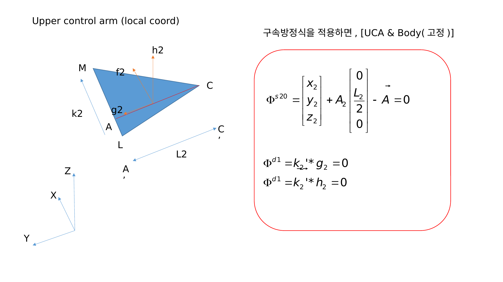

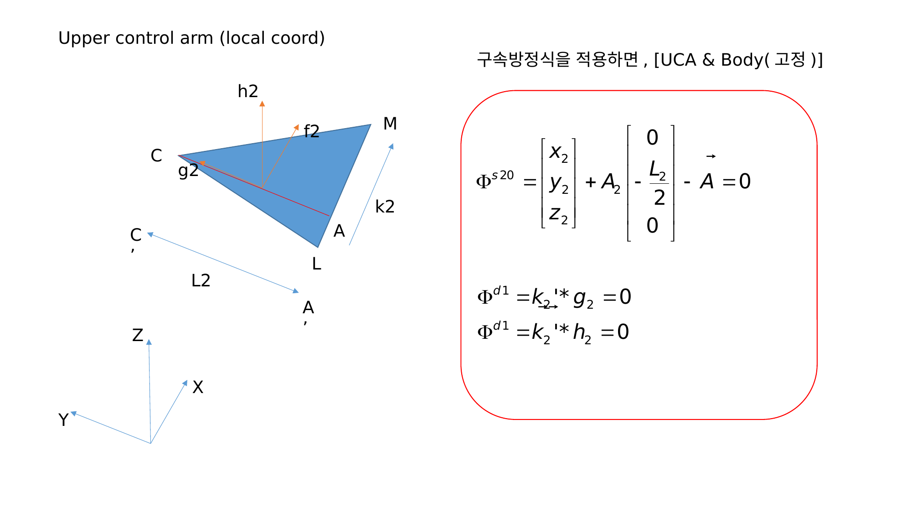

기본:

$$
\Phi^{s20} = \begin{bmatrix} x_2 \\ y_2 \\ z_2 \end{bmatrix} + A_2 \begin{bmatrix} 0 \\ \dfrac{L_2}{2} \\ 0 \end{bmatrix} - \vec{A} = 0
$$

ref:

$$
\Phi^{s20} = \begin{bmatrix} x_2 \\ y_2 \\ z_2 \end{bmatrix} + A_2 \begin{bmatrix} 0 \\ -\dfrac{L_2}{2} \\ 0 \end{bmatrix} - \vec{A} = 0
$$

공통:

$$
\Phi^{d1} = k_2' * g_2 = 0
$$

$$
\Phi^{d1} = k_2' * h_2 = 0
$$

### UCA & wheel 사이의 관계식

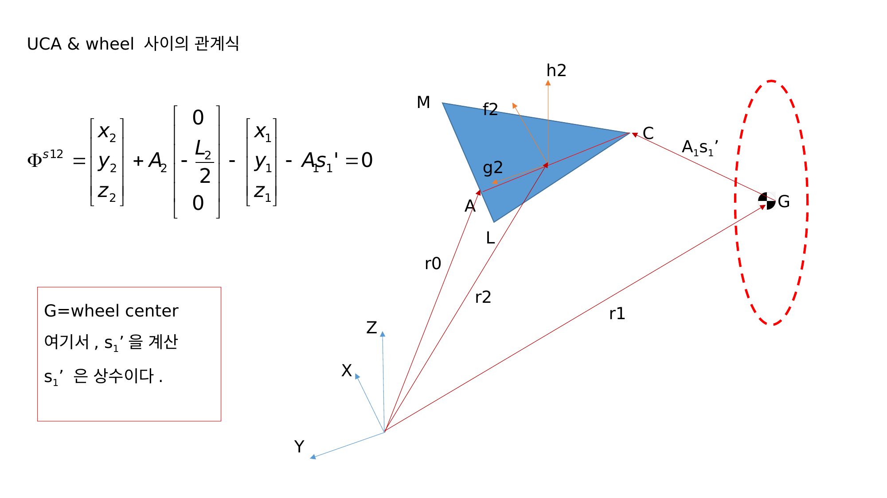

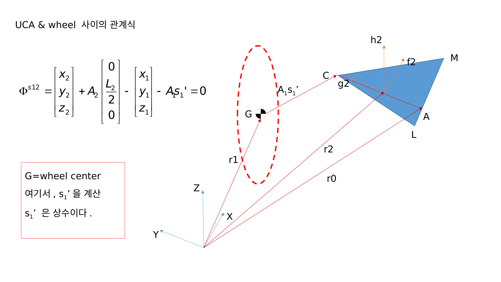

기본:

$$
\Phi^{s12} = \begin{bmatrix} x_2 \\ y_2 \\ z_2 \end{bmatrix} + A_2 \begin{bmatrix} 0 \\ -\dfrac{L_2}{2} \\ 0 \end{bmatrix} - \begin{bmatrix} x_1 \\ y_1 \\ z_1 \end{bmatrix} - A_1 s_1' = 0
$$

ref:

$$
\Phi^{s12} = \begin{bmatrix} x_2 \\ y_2 \\ z_2 \end{bmatrix} + A_2 \begin{bmatrix} 0 \\ \dfrac{L_2}{2} \\ 0 \end{bmatrix} - \begin{bmatrix} x_1 \\ y_1 \\ z_1 \end{bmatrix} - A_1 s_1' = 0
$$

> G=wheel center
> 여기서, s1'을 계산 — s1' 은 상수이다.

$$
A_1 \tilde{s}_1' = \tilde{s}_1 A_1
$$

s_tilda 는 Global 좌표이므로 C-G 를 이용하여 계산할 수 있다.

기본:

$$
s_1 = (40, 85, 225)
$$

$$
\tilde{s}_1 = \begin{bmatrix} 0 & -225 & 85 \\ 225 & 0 & -40 \\ -85 & 40 & 0 \end{bmatrix}
$$

$$
\tilde{s}_1' = A_1^T \tilde{s}_1 A_1 = \begin{bmatrix} 1 & 0 & 0 \\ 0 & 1 & 0 \\ 0 & 0 & 1 \end{bmatrix} \begin{bmatrix} 0 & -225 & 85 \\ 225 & 0 & -40 \\ -85 & 40 & 0 \end{bmatrix} \begin{bmatrix} 1 & 0 & 0 \\ 0 & 1 & 0 \\ 0 & 0 & 1 \end{bmatrix} \qquad \therefore\ s_1' = \begin{bmatrix} 40 \\ 85 \\ 225 \end{bmatrix}
$$

ref:

$$
s_1 = (24, -105.5, 395)
$$

$$
\tilde{s}_1 = \begin{bmatrix} 0 & -39.5 & -105.5 \\ 39.5 & 0 & -24 \\ 105.5 & 24 & 0 \end{bmatrix}
$$

$$
\tilde{s}_1' = A_1^T \tilde{s}_1 A_1 = \begin{bmatrix} 1 & 0 & 0 \\ 0 & 1 & 0 \\ 0 & 0 & 1 \end{bmatrix} \begin{bmatrix} 0 & -39.5 & -105.5 \\ 39.5 & 0 & -24 \\ 105.5 & 24 & 0 \end{bmatrix} \begin{bmatrix} 1 & 0 & 0 \\ 0 & 1 & 0 \\ 0 & 0 & 1 \end{bmatrix} \qquad \therefore\ s_1' = \begin{bmatrix} 24 \\ -105.5 \\ 39.5 \end{bmatrix}
$$

### Tie rod

UCA 에서 8개의 구속방정식 생성. 마찬가지 방법으로 tie rod 와 LCA 대해 위의 해석을 수행할 수 있다. Tie rod는 자유도 축소를 위해 F점에서 u.v. joint 로 연결한다.

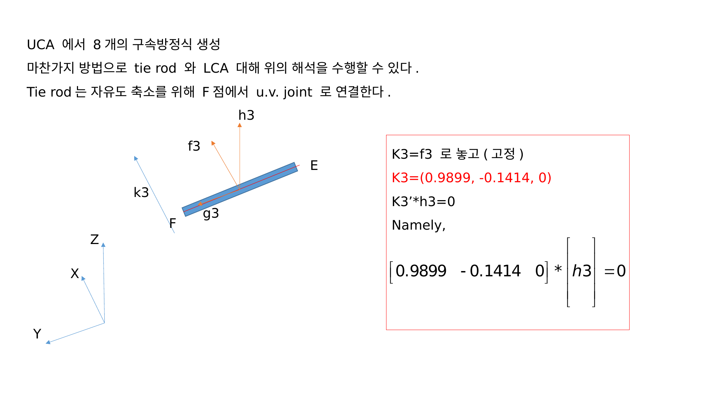

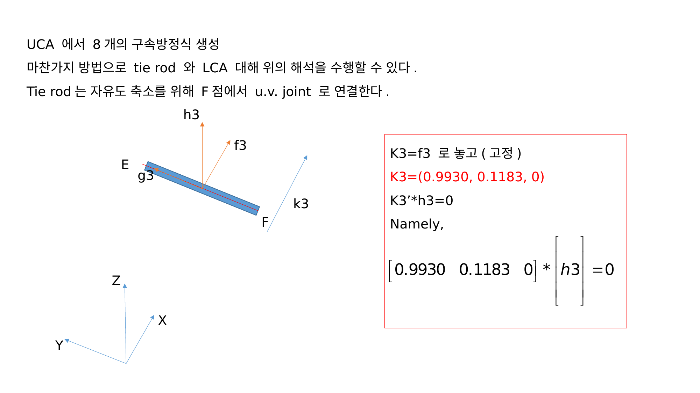

K3=f3 로 놓고(고정), K3'\*h3=0

| 항목 | 기본 | ref |
| --- | --- | --- |
| K3 | (0.9899, -0.1414, 0) | (0.9930, 0.1183, 0) |

기본:

$$
\begin{bmatrix} 0.9899 & -0.1414 & 0 \end{bmatrix} * \begin{bmatrix} h3 \end{bmatrix} = 0
$$

ref:

$$
\begin{bmatrix} 0.9930 & 0.1183 & 0 \end{bmatrix} * \begin{bmatrix} h3 \end{bmatrix} = 0
$$

### 구속방정식 개수

| 부품 | 구속방정식 |
| --- | --- |
| UCA | 8개 |
| Tie rod | 7개 |
| LCA | 8개 |
| **Total** | **23개** |

## 2-6. UCA의 Jacobian matrix

$$
\dot{\Phi}^{s20} = \begin{bmatrix} I & -A_2 \tilde{s}_2' \end{bmatrix} \begin{bmatrix} \dot{x}_2 \\ \dot{y}_2 \\ \dot{z}_2 \\ \omega_{2x}' \\ \omega_{2y}' \\ \omega_{2z}' \end{bmatrix} = 0
$$

기본:

$$
s_2' = \begin{bmatrix} 0 \\ \dfrac{L_2}{2} \\ 0 \end{bmatrix} = \begin{bmatrix} 0 \\ 116.4 \\ 0 \end{bmatrix}, \qquad \tilde{s}_2' = \begin{bmatrix} 0 & 0 & 116.4 \\ 0 & 0 & 0 \\ -116.4 & 0 & 0 \end{bmatrix}
$$

ref:

$$
s_2' = \begin{bmatrix} 0 \\ -\dfrac{L_2}{2} \\ 0 \end{bmatrix} = \begin{bmatrix} 0 \\ -86.1 \\ 0 \end{bmatrix}, \qquad \tilde{s}_2' = \begin{bmatrix} 0 & 0 & -86.1 \\ 0 & 0 & 0 \\ 86.1 & 0 & 0 \end{bmatrix}
$$

$$
\dot{\Phi}^{d1} = \begin{bmatrix} 0 & -a_0'^{T} A_0^T A_2 \tilde{a}_2' \end{bmatrix} \begin{bmatrix} \dot{x}_2 \\ \dot{y}_2 \\ \dot{z}_2 \\ \omega_{2x}' \\ \omega_{2y}' \\ \omega_{2z}' \end{bmatrix} = 0
$$

여기서,

$$
-a_0'^{T} A_0^T A_2 \tilde{a}_2' = -\left( A_0 a_0' \right)^T A_2 a_2'
$$

기본:

$$
A_0 a_0' = k_2 = f_2 = \begin{bmatrix} 0.9657 & -0.2575 & 0.0322 \end{bmatrix}'
$$

$$
-\left( A_0 a_0' \right)^T A_2 \tilde{a}_2' = -\begin{bmatrix} 0.9657 & -0.2575 & 0.0322 \end{bmatrix} A_2 a_2'
$$

ref:

$$
A_0 a_0' = k_2 = f_2 = \begin{bmatrix} 0.9984 & 0 & -0.0557 \end{bmatrix}'
$$

$$
-\left( A_0 a_0' \right)^T A_2 \tilde{a}_2' = -\begin{bmatrix} 0.9984 & 0 & -0.0557 \end{bmatrix} A_2 a_2'
$$

공통:

$$
a_2' = \begin{bmatrix} 0 \\ 1 \\ 0 \end{bmatrix}, \qquad a_2' = \begin{bmatrix} 0 \\ 0 \\ 1 \end{bmatrix}
$$

**UCA & wheel**

$$
\dot{\Phi}^{s12} = \begin{bmatrix} -I & A_1 \tilde{s}_1' & I & -A_2 \tilde{s}_2' \end{bmatrix} \begin{bmatrix} \dot{x}_1 \\ \dot{y}_1 \\ \dot{z}_1 \\ \omega_{1x}' \\ \omega_{1y}' \\ \omega_{1z}' \\ \dot{x}_2 \\ \dot{y}_2 \\ \dot{z}_2 \\ \omega_{2x}' \\ \omega_{2y}' \\ \omega_{2z}' \end{bmatrix} = 0
$$

기본:

$$
s_2' = \begin{bmatrix} 0 \\ -\dfrac{L_2}{2} \\ 0 \end{bmatrix} = \begin{bmatrix} 0 \\ -116.4 \\ 0 \end{bmatrix}, \qquad \tilde{s}_1' = \begin{bmatrix} 0 & -225 & 85 \\ 225 & 0 & -40 \\ -85 & 40 & 0 \end{bmatrix}, \qquad \tilde{s}_2' = \begin{bmatrix} 0 & 0 & -116.4 \\ 0 & 0 & 0 \\ 116.4 & 0 & 0 \end{bmatrix}
$$

ref:

$$
s_2' = \begin{bmatrix} 0 \\ \dfrac{L_2}{2} \\ 0 \end{bmatrix} = \begin{bmatrix} 0 \\ 86.1 \\ 0 \end{bmatrix}, \qquad \tilde{s}_1' = \begin{bmatrix} 0 & -39.5 & -105.5 \\ 39.5 & 0 & -24 \\ 105.5 & 24 & 0 \end{bmatrix}, \qquad \tilde{s}_2' = \begin{bmatrix} 0 & 0 & 86.1 \\ 0 & 0 & 0 \\ -86.1 & 0 & 0 \end{bmatrix}
$$

## 2-7. Initial suspension geometry

Tie rod와 LCA 도 마찬가지 방법으로 구속방정식 및 자코비안 계산이 가능하다. Initial suspension geometry는 아래와 같다. (① wheel, ② UCA, ③ Tie rod, ④ LCA)

**기본**

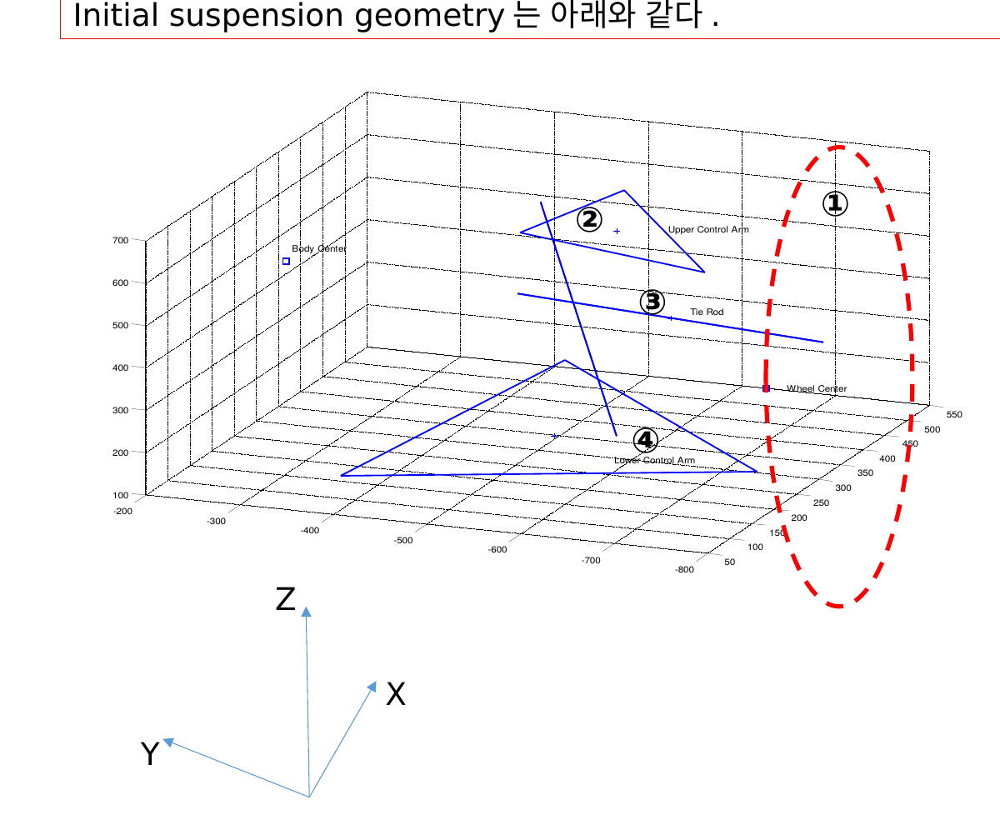

$$
A_1 = \begin{bmatrix} 1 & 0 & 0 \\ 0 & 1 & 0 \\ 0 & 0 & 1 \end{bmatrix}, \qquad A_2 = \begin{bmatrix} 0.9657 & -0.2577 & -0.0311 \\ 0.2575 & 0.9662 & -0.0083 \\ 0.0322 & 0 & 0.9995 \end{bmatrix}
$$

$$
A_3 = \begin{bmatrix} 0.9899 & -0.1414 & 0 \\ 0.1414 & 0.9899 & 0 \\ 0 & 0 & 1 \end{bmatrix}, \qquad A_4 = \begin{bmatrix} 0.9922 & -0.1204 & -0.0323 \\ 0.1240 & 0.9794 & 0.1594 \\ 0.0124 & -0.1621 & 0.9867 \end{bmatrix}
$$

**ref**

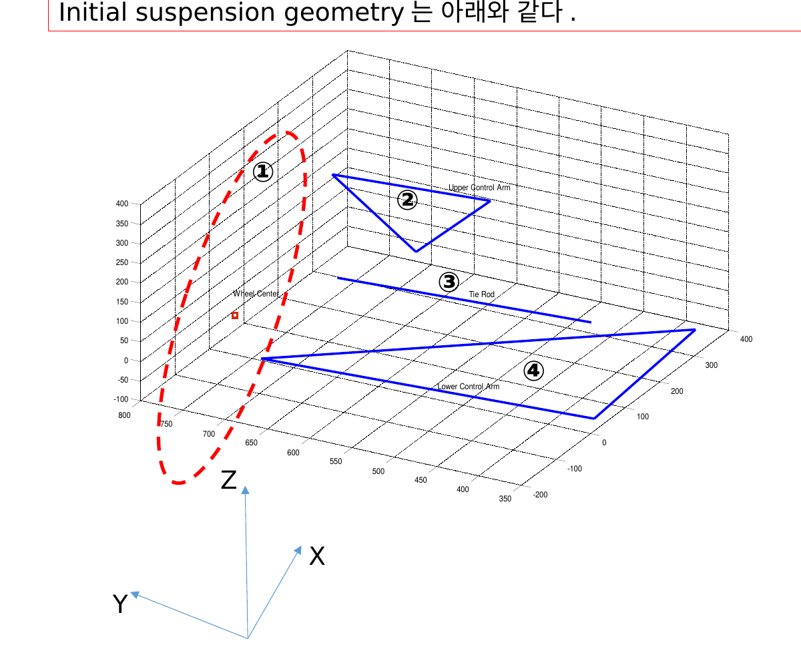

$$
A_1 = \begin{bmatrix} 1 & 0 & 0 \\ 0 & 1 & 0 \\ 0 & 0 & 1 \end{bmatrix}, \qquad A_2 = \begin{bmatrix} 0.9984 & 0.0026 & 0.0557 \\ 0 & 0.9989 & -0.0463 \\ -0.0557 & 0.0463 & 0.9974 \end{bmatrix}
$$

$$
A_3 = \begin{bmatrix} 0.9930 & -0.1183 & -0.0002 \\ 0.1183 & 0.9930 & 0.0017 \\ 0 & -0.0017 & 1 \end{bmatrix}, \qquad A_4 = \begin{bmatrix} 0.9990 & -0.0423 & -0.0136 \\ 0.0428 & 0.9985 & 0.0330 \\ 0.0122 & -0.0335 & 0.9994 \end{bmatrix}
$$

## 2-8. 기구학 해석 결과

휠의 x, y, z 위치와 camber, spin, toe 변화입니다.

**기본 — 해석결과 (오른쪽 바퀴)**

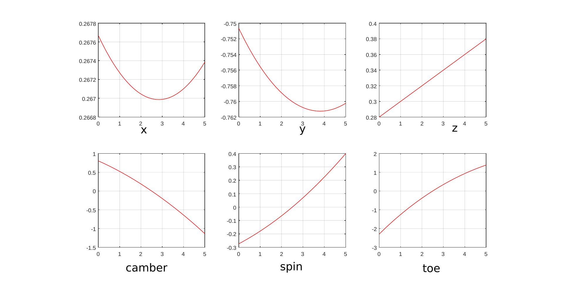

**기본 — 참고 (왼쪽 바퀴)**

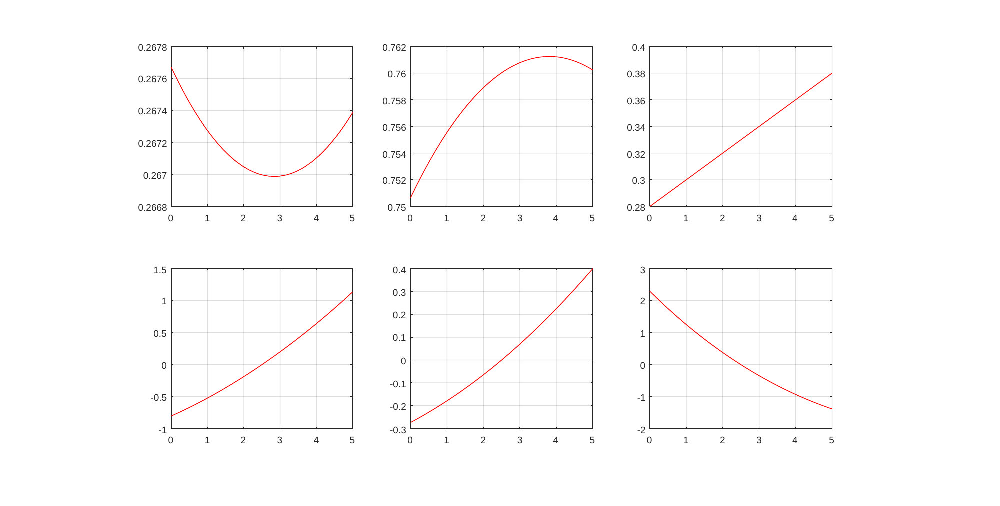

**ref — 해석 결과**

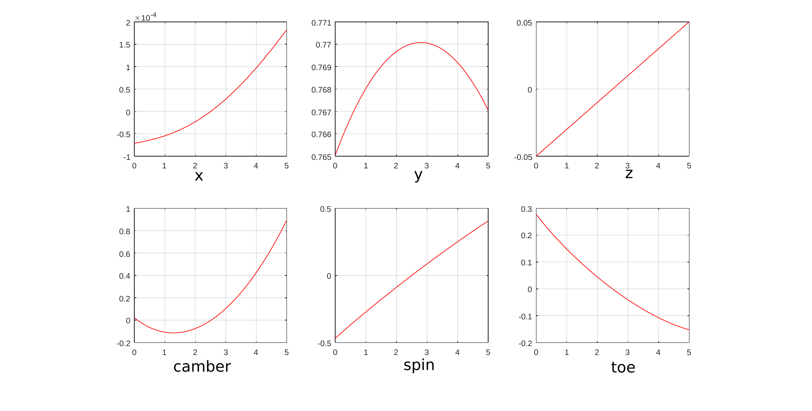

**ref — 참고**

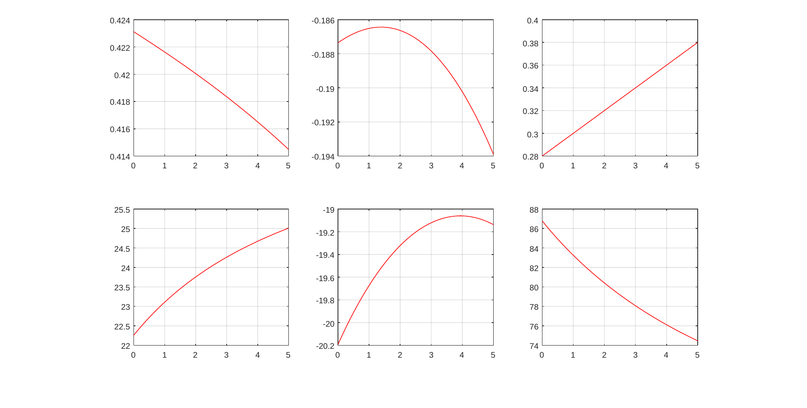

> 🔗 **다음 장과의 연결** — 여기서 얻은 휠 위치·자세 곡선(x, y, z, camber, spin, toe)이 3장 FSM 코드의 Quarter car model (Kinematics)에서 tyre 그래프로 다시 나타나며, FSM 코드에서는 이를 스트로크의 다항식으로 근사(curve fitting)해 사용합니다.

---

# 3. FSM 동역학 모델 (MATLAB)

FSM(Functional Suspension Model) 코드는 Quarter car model에서 시작해 Full car model로 확장되었습니다.

| 단계 | 코드 | 내용 |
| --- | --- | --- |
| Quarter car — McPherson | fsm_suspension60_kms.m / fsm_suspension60.m | Kinematics → Dynamics (-> fsm_suspension_full91.m) |
| Quarter car — Double wishbone | fsm_suspension70_kms.m / fsm_suspension70.m | Kinematics → Dynamics |
| Quarter car — 실제 해석 모델 | fsm_suspension72_kms.m | 실제 해석에 사용한 모델 (-> fsm_suspension_full98.m) |
| Full car | fsm_suspension_full90.m / full91.m | 정적 평형, roll·pitch·yaw 모델 완성 |
| Full car — 주행 해석 | fsm_suspension_full99.m | step steering, 코너링 compliance |

## 3-1. Quarter car model

### McPherson — Kinematics (fsm_suspension60_kms.m)

Quarter car model (Kinematics), McPherson — **curve fitting 필요**

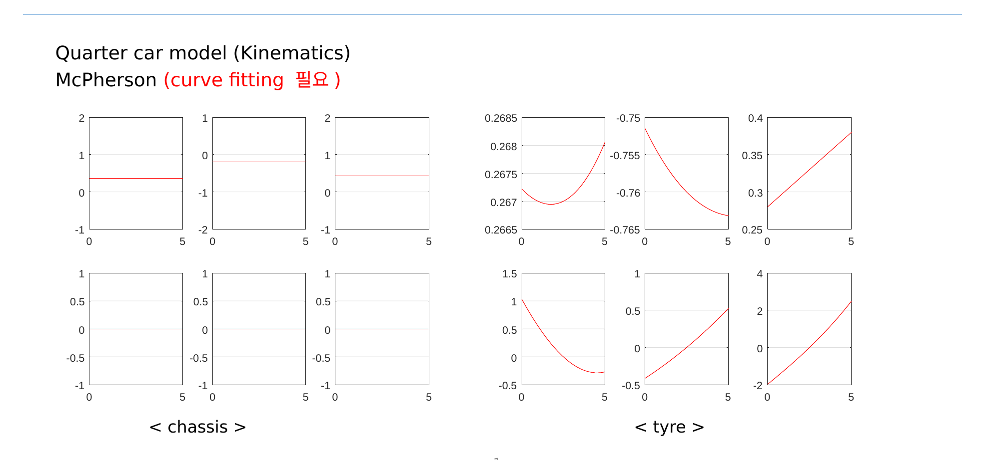

### McPherson — Kinematics (suspension_kinematics_mc4.m)

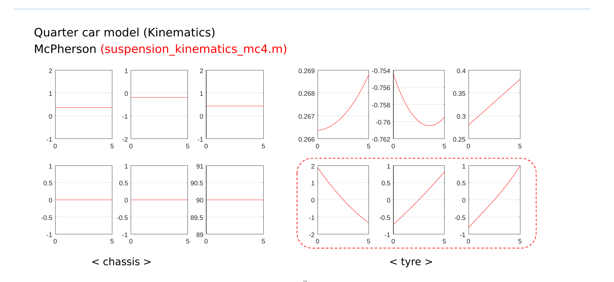

### McPherson — Dynamics (fsm_suspension60.m)

Quarter car model (Dynamics) — **McPherson -> fsm_suspension_full91.m**

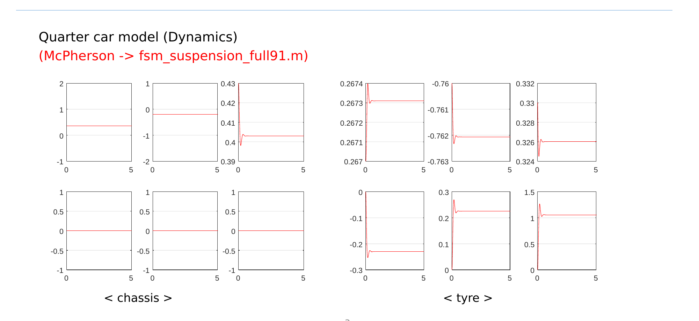

### Double wishbone — Kinematics (fsm_suspension70_kms.m)

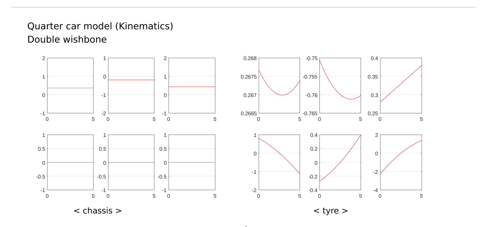

### Double wishbone — Dynamics (fsm_suspension70.m)

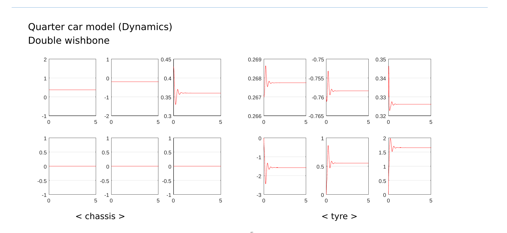

### 실제 해석에 사용한 모델 (fsm_suspension72_kms.m)

Quarter car model (Dynamics) — **실제 해석에 사용한 모델 -> fsm_suspension_full98.m**

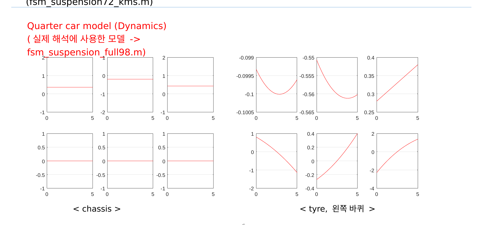

## 3-2. 커플러 커브 — Camber / Toe 각변화 다항식

fsm_suspension72_kms.m 에서 camber, toe 각변화는 스트로크 dwb2의 3차 다항식으로 표현됩니다.

```matlab
phi2x=(-0.264*dwb2.^3-1.1635*dwb2.^2-0.3381*dwb2);   % camber 각변화
phi2z=(3.8412*dwb2.^3-3.1675*dwb2.^2+0.6309*dwb2);   % toe 각변화
```

![camber 각변화 / toe 각변화 ([deg] vs [mm])](images/fsm_29.png)

> 🔗 **FMU 코어와의 연결** — 이 다항식은 4장 C 코어의 「커플러 커브 기구학」에 같은 계수(ph2x, ph2z)로 그대로 들어가 있습니다.

## 3-3. Full car model (fsm_suspension_full91.m)

### 하드 포인트

**Fsm_suspension_full90**

```matlab
J=1e-3*[0 0 430]';              % Center of Body
STU_FL=1e-3*[1000 965 680]';    % Strut mount Upper left
STL_FL=1e-3*[1000 965 555]';    % Strut mount Lower left
STU_FR=1e-3*[1000 -965 680]';   % Strut mount Upper right
STL_FR=1e-3*[1000 -965 555]';   % Strut mount Lower right
STU_RL=1e-3*[-1000 965 680]';   % Strut mount Upper left_rear
STL_RL=1e-3*[-1000 965 555]';   % Strut mount Lower left_rear
STU_RR=1e-3*[-1000 -965 680]';  % Strut mount Upper right_rear
STL_RR=1e-3*[-1000 -965 555]';  % Strut mount Lower right_rear
```

**Fsm_suspension_full91**

```matlab
J=1e-3*[0 0 430]';              % Center of Body
STU_FL=1e-3*[1000 700 680]';    % Strut mount Upper left
STL_FL=1e-3*[1000 800 180]';    % Strut mount Lower left
STU_FR=1e-3*[1000 -700 680]';   % Strut mount Upper right
STL_FR=1e-3*[1000 -800 180]';   % Strut mount Lower right
STU_RL=1e-3*[-1200 965 680]';   % Strut mount Upper left_rear
STL_RL=1e-3*[-1200 965 555]';   % Strut mount Lower left_rear
STU_RR=1e-3*[-1200 -965 680]';  % Strut mount Upper right_rear
STL_RR=1e-3*[-1200 -965 555]';  % Strut mount Lower right_rear
```

### 차량의 기호와 자유도

- 차체 자유도: roll, pitch, vertical direction (3)
- 타이어 자유도: vertical direction (4)
- **Total: 7자유도**

| Body | 번호 |
| --- | --- |
| Chassis | body#1 |
| FL | body#2 |
| FR | body#3 |
| RL | body#4 |
| RR | body#5 |

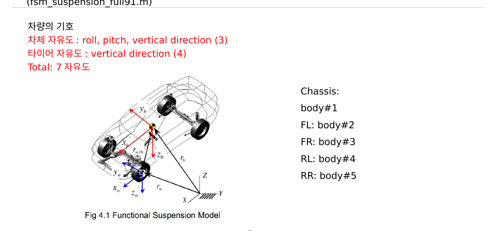

### 초기 조건

```matlab
V=50/3.6;
T=0;
R=0;
Kf=38925;
Kr=38255;
D=30*pi/180;
qb_dot=[0 0 0 0 0 0]';
qw_dot=zeros(24,1);
q_dot=[qb_dot;qw_dot];
g=9.81;
```

```matlab
M1=[1400*eye(3) zeros(3,27);zeros(1,3) 48131000e-4 zeros(1,26);zeros(1,4) ...
    24038000e-4 zeros(1,25);zeros(1,5) 24038000e-4 zeros(1,24)];  % body
M2=[zeros(3,6) 25*eye(3) zeros(3,21);zeros(1,9) 800000e-6 zeros(1,20);zeros(1,10) 1000000e-6 zeros(1,19);...
    zeros(1,11) 800000e-6 zeros(1,18)];  % wheel FR
M3=[zeros(3,12) 25*eye(3) zeros(3,15);zeros(1,15) 800000e-6 zeros(1,14);zeros(1,16) ...
    1000000e-6 zeros(1,13);zeros(1,17) 800000e-6 zeros(1,12)];  % wheel FL
M4=[zeros(3,18) 25*eye(3) zeros(3,9);zeros(1,21) 800000e-6 zeros(1,8);zeros(1,22) ...
    1000000e-6 zeros(1,7);zeros(1,23) 800000e-6 zeros(1,6)];  % wheel RR
M5=[zeros(3,24) 25*eye(3) zeros(3,3);zeros(1,27) 800000e-6 zeros(1,2);zeros(1,28) ...
    1000000e-6 zeros(1,1);zeros(1,29) 800000e-6];  % wheel RL
```

```matlab
D(i)=10*pi/180;
% D(i)=5*pi/180*sin(0.4*i./1000);
```

### 평형 상태에서 타이어의 orientation

**Camber** — 좌·우 모두 0.25° Camber out

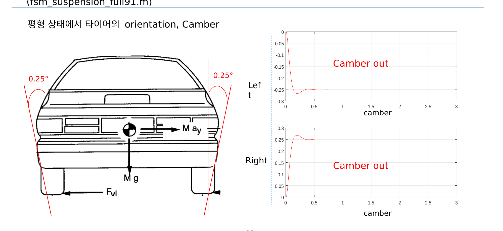

**Toe** — 좌·우 모두 1.25° Toe out

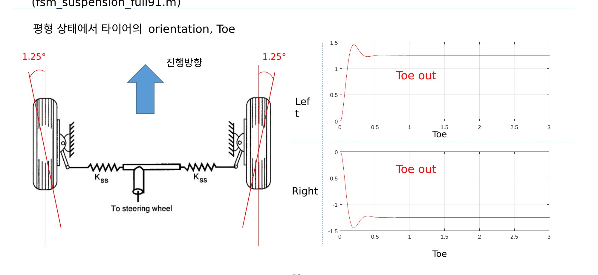

### Side 슬립각 & Yaw 율

| 코드 | 내용 |
| --- | --- |
| fsm_suspension_full90.m | 정적 평형 해석, 휠의 toe, camber, spin 정보 입력 / 무게중심 위치에 따른 pitch 운동 계산 / 모멘트를 yaw rate, slip angle 의 함수로 적용할 것 / 정확한 모델 |
| fsm_suspension_full91.m | 위 내용 + Lower control arm 적용 / 최종 완성함 (roll, pitch, yaw 모델 완성) |

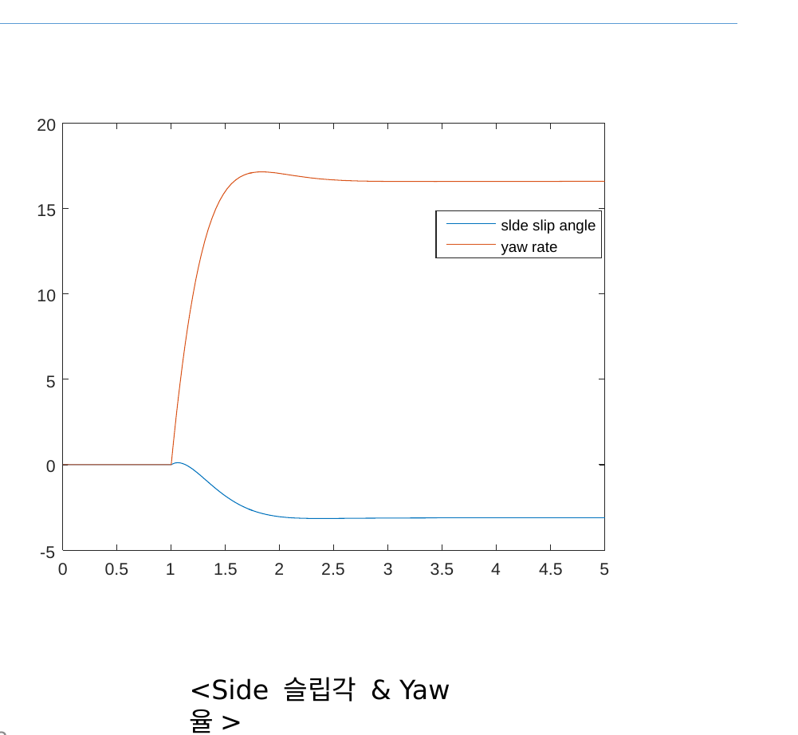

## 3-4. Step steering 해석 (fsm_suspension_full99.m)

### 초기 조건 — 조향각 4deg step steering

```matlab
V=100/3.6;               % chassis velocity
T=0;                     % slip angle
R=0;                     % yaw rate
Kf=38925;
Kr=38255;
D=30*pi/180;             % steering angle
qb_dot=[0 0 0 0 0 0]';
qw_dot=zeros(24,1);
q_dot=[qb_dot;qw_dot];
g=9.81;
```

```matlab
if i>1000
    D(i)=4*pi/180;
else
    D(i)=0;
end
```

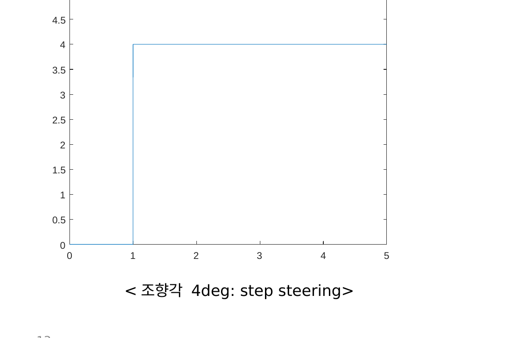

> 🔗 **검증 시나리오와의 연결** — 100 km/h, 조향각 4° step 조건은 6장 FMU 검증의 「테스트 A」와 같은 조건입니다.

### Side slip angle / Yaw rate

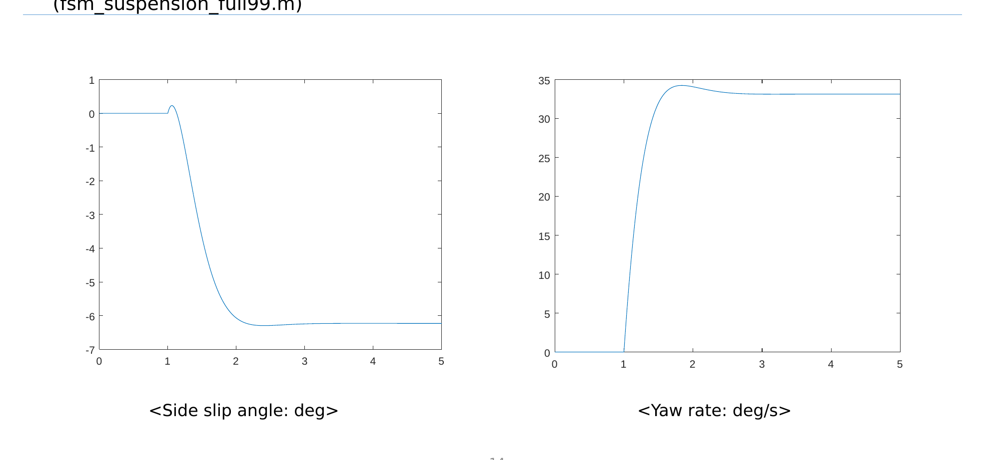

### Lateral acceleration / Roll angle

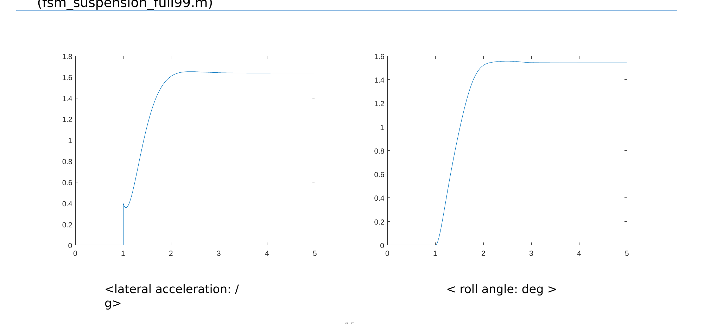

### 차체의 변위 (x, y, z, roll, pitch, yaw)

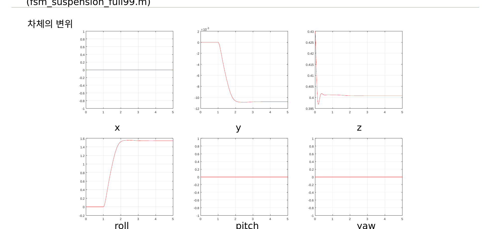

### 타이어의 변위 (FL, FR, RL, RR)

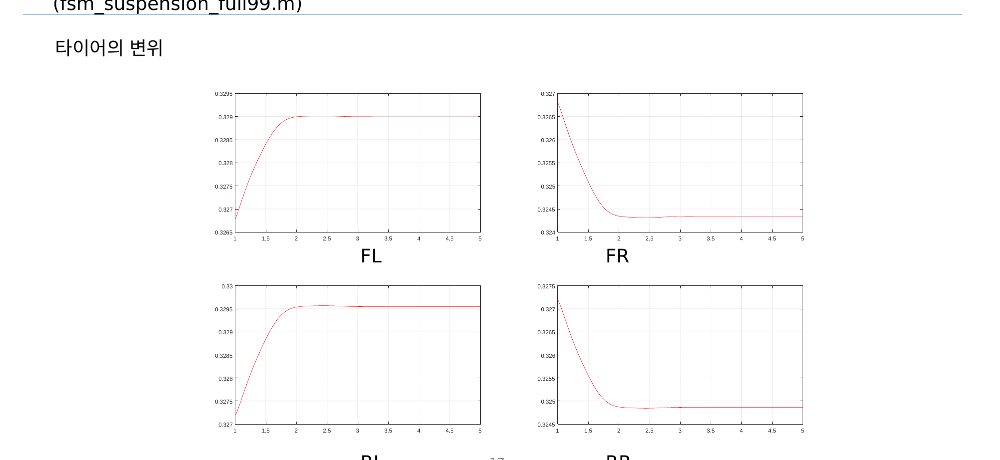

### 차체와 타이어의 상대변위

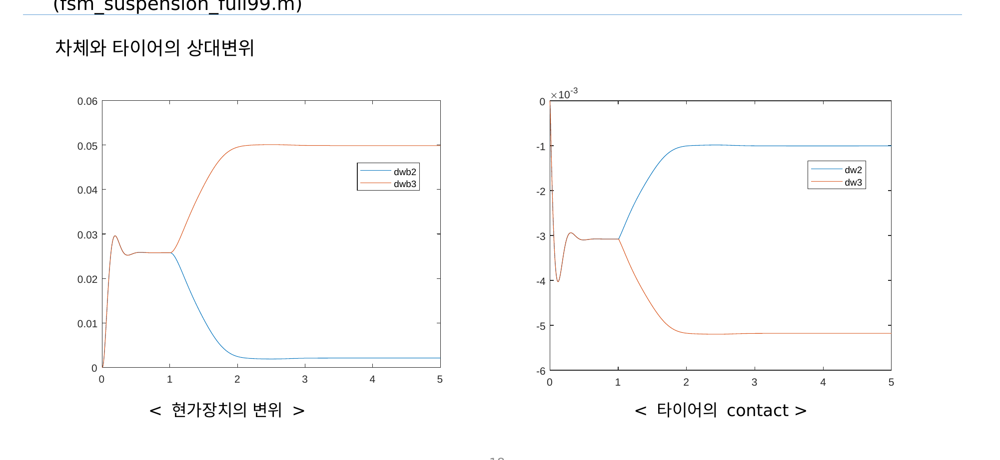

### 횡방향 하중이동

- v_FL = 1200N
- v_FR = 6500N
- v_FS = 3850N

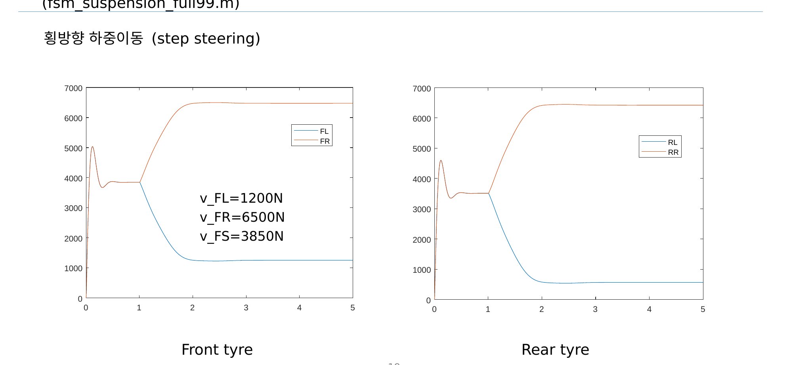

### 코너링 force

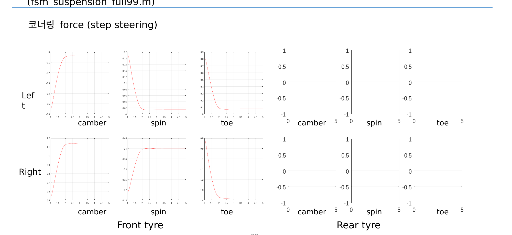

## 3-5. 코너링 compliance (fsm_suspension_full99.m)

### 보정 계수 검토

**보정 있음**

```matlab
% with correction factor
% DTOE=-0.5*((phi2z-0.8*pi/180)+(phi3z+0.8*pi/180));
% DCAMBER=0.5*0.1*((phi2x+0.55*pi/180)+(phi3x-0.55*pi/180));
```

**보정 없음**

```matlab
% without correction factor
DTOE=-0.5*((phi2z)+(phi3z));
DCAMBER=0.5*0.1*((phi2x+phi1x)+(phi3x+phi1x));
% DCAMBER=0;
```

> 전륜에만 코너링 compliance 적용
> 보정을 위해 -0.8 과 +0.8 을 삽입했지만, 이미 그 자체로 코너링 compliance에 영향을 주기 때문에 보정값은 삭제하는게 맞음

### Slip angle / Yaw rate (compliance 유무 비교)

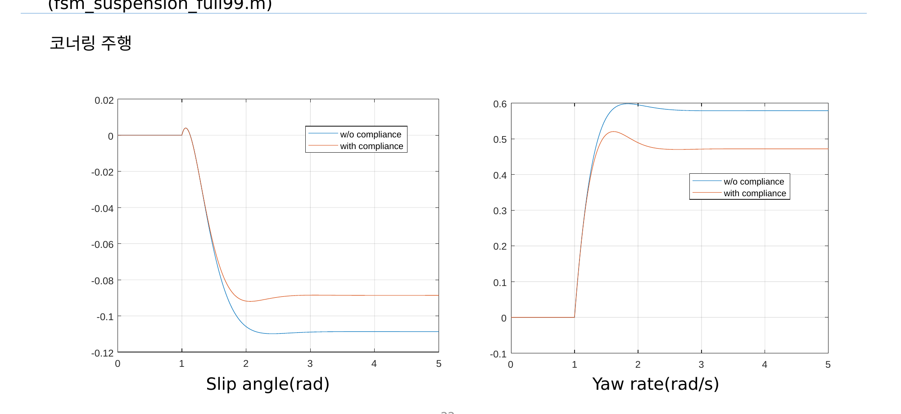

### DCAMBER vs DTOE

> Camber angle(deg)의 변화보다 Toe angle(deg)의 변화가 코너링에 더 큰 영향을 준다.

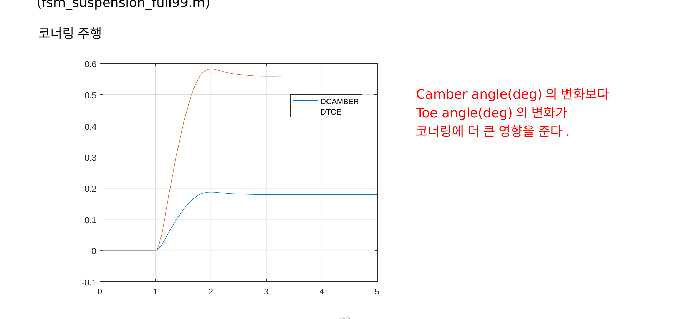

### 정상 원선회 궤적 — Toe compliance

> 전륜의 compliance 영향으로 정상 원선회 궤적이 달라진다. Toe angle 은 부족조향 경향이 있음

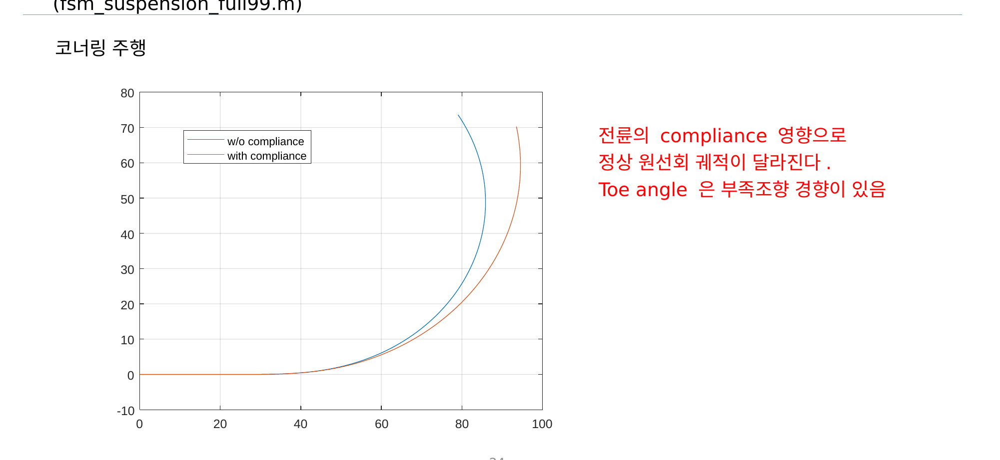

### 정상 원선회 궤적 — Camber compliance

> 전륜의 compliance 영향으로 정상 원선회 궤적이 달라진다. camber angle 은 부족조향 경향이 있음 (camber thrust 증가)

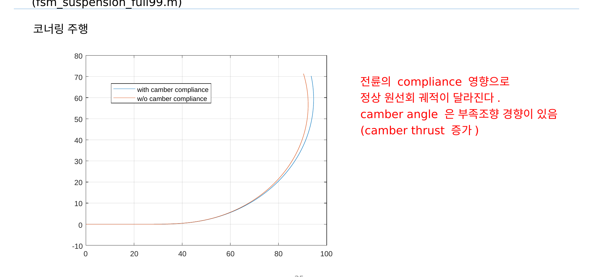

### 캠버각과 횡력

무게 중심점에서 모멘트 평형

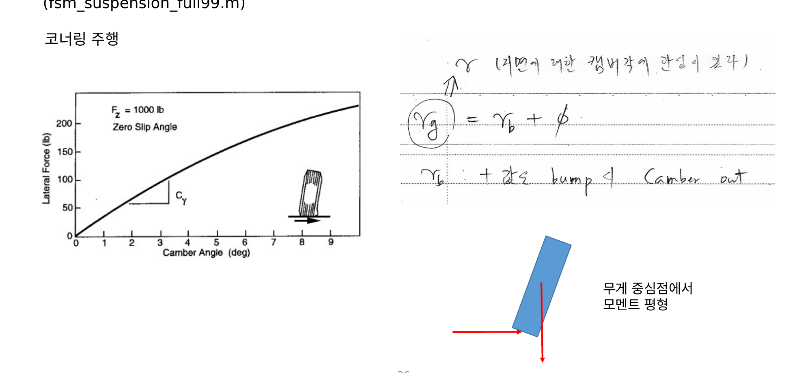

### 횡방향 하중 이동

> 횡방향 하중 이동에 의해 부족조향 경향이 있음

```matlab
% without lateral load transfer
% DTOE=-0.5*((0.8*pi/180)+(-0.8*pi/180));
% DCAMBER=0.5*0.1*((-0.55*pi/180)+(0.55*pi/180));
```

원심력(횡력)에 의해 타이어의 캠버각이 발생하며, 이를 고려하여 코너링 compliance를 재계산 해야한다.

- 횡방향 하중에 의한 캠버각 고려
  - -> phi1x 포함으로 해결 완료
  - -> 휠의 align 은 차체 롤을 따라감

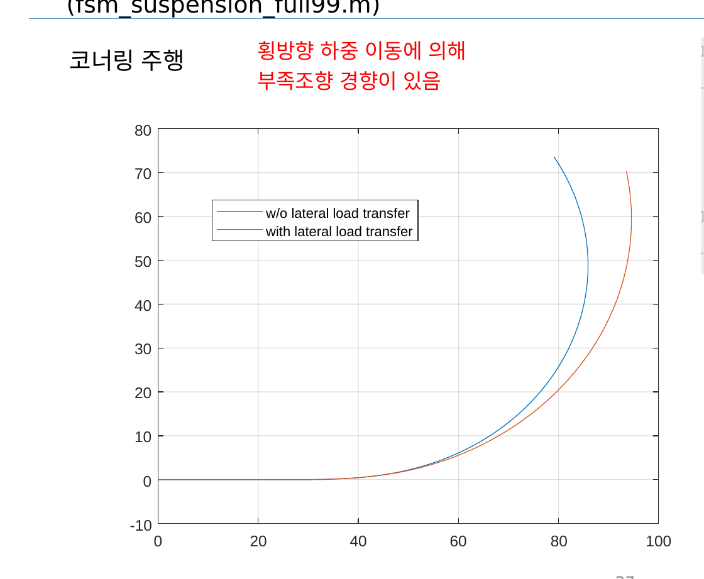

> 🔗 **FMU 코어와의 연결** — 여기서 정한 DTOE, DCAMBER는 FMU의 출력 변수(얼라인먼트)로 나가고, C 코어에서는 DTOE가 유효 조향각 δ_eff 계산에 반영됩니다. (4-4, 5-4 참조)

## 3-6. 3자유도 Bicycle model과의 비교 검증

FSM 코드 결과를 roll 운동을 포함한 3자유도 bicycle model(ode45)과 비교했습니다.

### ① roll 운동만 포함 (Bicycle_dynamics_roll2)

- 3자유도 모델: roll 운동 포함
- 횡방향 하중 이동량 계산불가 -> 횡력 계산 불가
- dwb= 0.965\*rad 으로 계산
- Y_phi=N_phi=0

```matlab
function Rp=Bicycle_dynamics_roll2(t,y)

M=1400;
Jy=2400;  % yaw moment of inertia
Jr=4813;  % roll moment of inertia
Lf=1.0;
Lr=1.2;
hs=0.5-0.035;
Kf=38925;
Kr=38255;
K_roll=200000*2;
C_roll=20000;

g=9.81;   % acceleration of gravity (m/s^2)
V=100/3.6;  % velocity of carbody (m/s)

if t>1
    delta=4*pi/180;
else
    delta=0;
end

C2=[M*V 0 0 -M*hs;0 Jy 0 0;-M*hs*V 0 0 Jr;0 0 1 0];
Rp=C2\[-2*(Kf+Kr)*y(1)-(M*V+2*(Lf*Kf-Lr*Kr)./V)*y(2)+2*Kf*delta;...
    -2*(Lf*Kf-Lr*Kr)*y(1)-2*(Lf^2*Kf+Lr^2*Kr)./V*y(2)+2*Lf*Kf*delta;...
    M*hs*V*y(2)-(K_roll-M*g*hs)*y(3)-C_roll*y(4);y(4)];
```

### ② Roll Steer / Camber Change 포함 (Bicycle_dynamics_roll3)

$$
Y_\phi = \left( \frac{\partial \alpha_f}{\partial \phi} K_f + \frac{\partial \alpha_r}{\partial \phi} K_r \right) - \left( \frac{\partial \phi_f}{\partial \phi} K_{cf} + \frac{\partial \phi_r}{\partial \phi} K_{cr} \right)
$$

$$
N_\phi = \left( \frac{\partial \alpha_f}{\partial \phi} l_f K_f - \frac{\partial \alpha_r}{\partial \phi} l_r K_r \right) - \left( \frac{\partial \phi_f}{\partial \phi} l_f K_{cf} - \frac{\partial \phi_r}{\partial \phi} l_r K_{cr} \right)
$$

첫 번째 괄호: **Roll Steer**, 두 번째 괄호: **Camber Change**

```matlab
function Rp=Bicycle_dynamics_roll3(t,y)

M=1400;
Jy=2400;  % yaw moment of inertia
Jr=4813;  % roll moment of inertia
Lf=1.0;
Lr=1.2;
hs=0.5-0.035;
Kf=38925;
Kr=38255;
K_roll=200000*2;
C_roll=20000;

g=9.81;   % acceleration of gravity (m/s^2)
V=100/3.6;  % velocity of carbody (m/s)

if t>1
    delta=4*pi/180;
else
    delta=0;
end

phi1x=y(3);
dwb2=-0.965*phi1x+0.02578;
dwb3=0.965*phi1x+0.02578;  % from equilibrium position
phi2x=(-0.264*dwb2.^3-1.1635*dwb2.^2-0.3381*dwb2);
phi3x=-(-0.264*dwb3.^3-1.1635*dwb3.^2-0.3381*dwb3);
phi2z=(3.8412*dwb2.^3-3.1675*dwb2.^2+0.6309*dwb2);
phi3z=-(3.8412*dwb3.^3-3.1675*dwb3.^2+0.6309*dwb3);
DTOE=-0.5*((phi2z)+(phi3z));
DCAMBER=0.5*0.1*(phi2x+phi3x+2*phi1x);

C2=[M*V 0 0 -M*hs;0 Jy 0 0;-M*hs*V 0 0 Jr;0 0 1 0];
Rp=C2\[-2*(Kf*(y(1)+DTOE+DCAMBER)+Kr*y(1))-(M*V+2*(Lf*Kf-Lr*Kr)./V)*y(2)+2*Kf*delta;...
    -2*(Lf*Kf*(y(1)+DTOE+DCAMBER)-Lr*Kr*y(1))-2*(Lf^2*Kf+Lr^2*Kr)./V*y(2)+2*Lf*Kf*delta;...
    M*hs*V*y(2)-(K_roll-M*g*hs)*y(3)-C_roll*y(4);y(4)];

% Tspan=0:0.01:5;
% y0=[0 0 0 0];
% [t y]=ode45(@Bicycle_dynamics_roll3,Tspan,y0);
% y(1)=slip angle; y(2)=yaw rate; y(3)=roll disp
```

**ode45 vs FSM code (fsm_suspension_full99.m)**

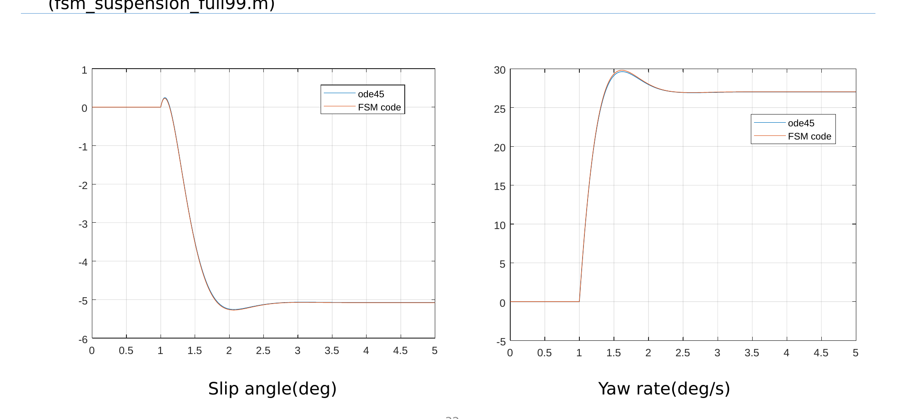

### ③ 기울기를 이용한 선형화 (Bicycle_dynamics_roll4)

3-2의 다항식 곡선에서 평형 위치(25.8mm)의 기울기를 이용하여 컴플라이언스를 계산합니다.

| 구분 | 평형 위치 | 기울기 |
| --- | --- | --- |
| camber 각변화 | 25.8mm | -1.5deg/70mm |
| toe 각변화 | 25.8mm | 2.0deg/70mm |

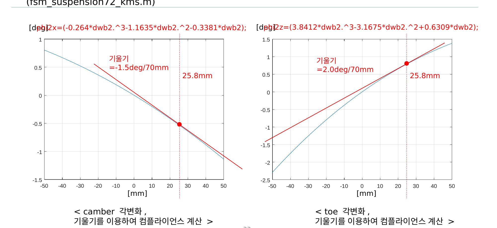

```matlab
function Rp=Bicycle_dynamics_roll4(t,y)

M=1400;
Jy=2400;  % yaw moment of inertia
Jr=4813;  % roll moment of inertia
Lf=1.0;
Lr=1.2;
hs=0.5-0.035;
Kf=38925;
Kr=38255;
K_roll=200000*2;
C_roll=20000;

g=9.81;   % acceleration of gravity (m/s^2)
V=100/3.6;  % velocity of carbody (m/s)

if t>1
    delta=4*pi/180;
else
    delta=0;
end

C2=[M*V 0 0 -M*hs;0 Jy 0 0;-M*hs*V 0 0 Jr;0 0 1 0];

phi1x=y(3);
dwb2=-0.965*phi1x + 0.02578;
dwb3=0.965*phi1x + 0.02578;  % from equilibrium position

phi2x=-1.5*pi/180/0.07*dwb2;
phi3x=1.5*pi/180/0.07*dwb3;
phi2z=2*pi/180/0.07*dwb2;
phi3z=-2*pi/180/0.07*dwb3;

DTOE=-0.5*((phi2z)+(phi3z));
DCAMBER=0.5*0.1*(phi2x+phi3x+2*phi1x);

Rp=C2\[-2*(Kf*(y(1)+DTOE+DCAMBER)+Kr*y(1))-(M*V+2*(Lf*Kf-Lr*Kr)./V)*y(2)+2*Kf*delta;...
    -2*(Lf*Kf*(y(1)+DTOE+DCAMBER)-Lr*Kr*y(1))-2*(Lf^2*Kf+Lr^2*Kr)./V*y(2)+2*Lf*Kf*delta;...
    M*hs*V*y(2)-(K_roll-M*g*hs)*y(3)-C_roll*y(4);y(4)];
% Tspan=0:0.01:5;
% y0=[0 0 0 0];
% [t y]=ode45(@Bicycle_dynamics_roll4,Tspan,y0);
% y(1)=slip angle; y(2)=yaw rate; y(3)=roll disp
```

**ode45 linear vs nonlinear (fsm_suspension72_kms.m)**

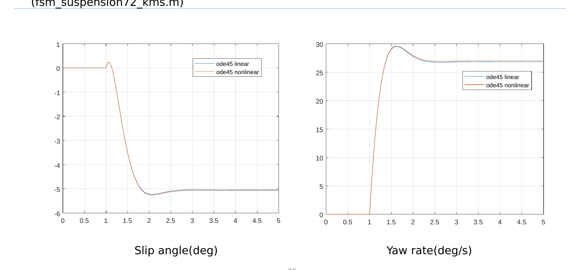

### Position / Velocity

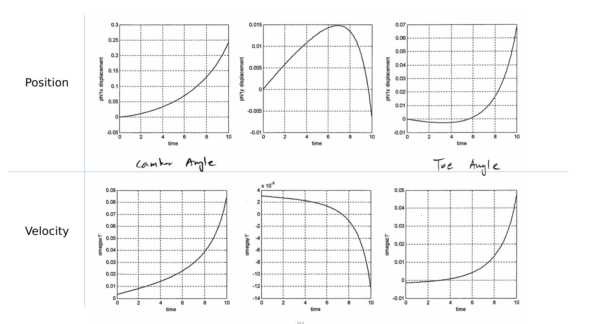

> 🔗 **다음 장과의 연결** — 여기까지의 MATLAB FSM 모델(서스펜션 스트로크, 커플러 커브, 타이어 횡력, 요·슬립 거동)을 매 스텝 1회 계산하는 C 코어로 옮긴 것이 4장입니다.

---

# 4. C 코어 이식 — FSM Suspension Core

MATLAB S-Function 모델을 C 언어 1ms 고정 스텝 코어(fsm_suspension_core_from_m_original_strict.c/.h)로 이식했습니다. 주요 함수는 fsm_state_reset() 과 fsm_step() 입니다.

## 4-1. 상태 구조 (FsmState)

| 분류 | 내용 |
| --- | --- |
| 차체 자세/위치 | T, R, R2, Xg, Yg, DH, x1,y1,z1, ph1x,ph1y,ph1z |
| 휠 좌표계(A1–A5) | 차체·4륜 회전행렬 A1~A5[9], 휠 중심 위치 x2..x5,y2..y5,z2..z5 |
| 구속조건 기하 | E2–E5[36], D2–D5[36], RI2–RI5[6] — 상대 구속·커플러 자코비안 |
| 일반화 동역학 | B[300], H[30], QA[30], Mdiag[30], qb[6], qdot[30] |
| 적분 상태 | X[8], Xdot_prev[8] — 서스펜션 스트로크·조향각속도 계열(AB2 적분) |
| 보조 텐서 | s16t..s59t[9], s16..s59[3] — 스프링 부착점 스큐(skew) 벡터 |

- state.stepIndex(정수)가 매 fsm_step 호출마다 1씩 증가하며, ca_delay[1000] 순환 버퍼로 후륜측 노면입력에 1000-스텝(=1s) 지연을 구현합니다.
- lastOutput[35]에는 직전 스텝의 출력이 캐시되어 재조회에 활용됩니다.

## 4-2. fsm_step() 실행 흐름 (매 1ms)

1. **가속도 해석** — compute_Aeq_beq → solve10(Aeq,beq) 로 10-DOF 일반화 가속도 qdd 산출
2. **속도·자세 적분** — qb_dot 적분(Euler) → Cw1 역행렬로 오일러각속도 환산 → 차체 위치/자세 갱신
3. **서스펜션 스트로크 적분** — X[8] 상태를 Adams–Bashforth 2차(AB2)로 적분, dw2–dw5 클램프(±0.20)
4. **커플러 기구학 갱신** — 다항식 커플러 커브로 휠 x,y,z / 자세각(ph2,ph3) 계산 후 A2–A5 회전행렬 갱신
5. **구속 자코비안 갱신** — build_E_D, RI2–RI5(다항식), build_B 로 E/D/B 재구성 → 다음 스텝 Aeq 준비
6. **힘 계산** — spring_force(스프링-댐퍼) + tire_fy_pacejka(횡력) + Fzt(타이어 수직력, Kt/Ct)
7. **일반화 하중 QA 조립** — add_Q_body / wheel_Q 로 차체·4륜 하중을 QA[30]에 반영 (롤모멘트 RM, 파워모멘트 PM 포함)
8. **차량 횡방향 동역학** — 2자유도 bicycle-model 형태로 T(슬립각속도), R(요레이트) 적분, af/ar/Fyf/Fyr 산출
9. **출력 조립** — y[0..34]에 자세·스트로크·얼라인먼트·진단값 기록, ca_delay 버퍼 업데이트, stepIndex++

## 4-3. 핵심 서브시스템 ① — 커플러 커브 기구학

더블 위시본(전륜) 서스펜션의 범프-토·캠버 특성은 스트로크(dwb2, dwb3)의 3차 다항식으로 근사되어, 휠 위치(x2,y2)·자세각(ph2x, ph2y, ph2z)을 즉시 계산합니다. 이는 원본 MATLAB 모델의 lookup/피팅 커브를 그대로 이식한 것으로, 매 스텝 비선형 기구 구속을 별도로 풀지 않고 닫힌 해로 처리해 연산량을 크게 줄입니다.

**전륜 좌측 예시 (dwb2 기준, 3차 다항식 피팅)**

```
ph2x = -0.264·dwb2³ - 1.1635·dwb2² - 0.3381·dwb2
ph2y =  0.1526·dwb2³ + 0.4421·dwb2² + 0.1171·dwb2
ph2z =  3.8412·dwb2³ - 3.1675·dwb2² + 0.6309·dwb2
```

> 🔗 ph2x, ph2z 는 3-2의 MATLAB 다항식(phi2x, phi2z)과 같은 계수입니다.

RI2/RI3 (커플러 회전축 벡터)도 동일한 다항식 계열로 갱신되며, 속도 성분(RI_dot)까지 해석적으로 유도되어 동역학 방정식의 H(코리올리·구심 항) 계산에 사용됩니다.

- **구속 방식** — 후륜(RL/RR)은 고정 자세(0,0,0)의 평행 스트로크로 단순화, 전륜만 커플러 다항식 적용
- **안전 범위** — dw2–dw5는 ±0.20m, dwb2/dwb3는 ±0.30m로 클램프하여 다항식 외삽 오류 방지

## 4-4. 핵심 서브시스템 ② — 스프링·댐퍼 및 타이어 모델

### 스프링-댐퍼 힘 (spring_force)

```
f = Ks·(‖d‖ - L0) + Cs·(d·v_rel)/‖d‖
```

- d : 상·하 부착점 간 상대 위치벡터
- v_rel : 상대 속도(회전 효과 포함)
- Ks : 전륜 70,000 N/m · 후륜 50,000 N/m
- Cs : 2,000 N·s/m (공통)

### 타이어 횡력 — Pacejka Magic Formula

슬립각(α)과 수직하중(Fz)으로부터 좌우 1축(2륜) 합산 횡력을 산출하는 표준 Magic Formula 구조 (tire_fy_pacejka)를 계수 a0–a13(FsmTireParams)로 구현했습니다.

```
B = BCD/(C·D),  E = a6·Fz+a7
x1 = α + Sh
Fy = D·sin(C·atan(B·x1 − E·(B·x1−atan(B·x1)))) + Sv
```

### 전/후륜 횡력 적용

```
af = δ_eff − T − (Lf/V)·R
ar = −T + (Lr/V)·R
Fyf = 2·f(af, FzF),  Fyr = 2·f(ar, FzR)
```

- δ_eff = 조향각 + 16 × DTOE (능동 토(toe) 보정 반영)
- FzF, FzR는 좌우 타이어 수직력 평균값을 최소 100N으로 하한 처리

### 타이어 수직력 (노면 접촉)

```
Fzt = Kt·δ - Ct·ẋ   (δ > 0 일 때만, 그 외 0)
```

Kt = 200,000 N/m, Ct = 100 N·s/m — 노면 침투량 기반 수직 스프링-댐퍼

## 4-5. 핵심 서브시스템 ③ — 조향/횡방향(2자유도) 동역학

차체 요-슬립 거동은 전/후 타이어 횡력을 이용한 2자유도(2-DOF) 등가 bicycle model 형태로 표현됩니다. T는 차체 슬립각(속도) 상태, R은 요레이트(yaw rate) 상태이며, 매 스텝 오일러 적분으로 갱신되어 커플러 커브 및 스프링력 계산에 사용되는 유효 조향각(δ_eff), 롤모멘트(RM), 파워모멘트(PM) 산출의 입력이 됩니다.

**상태 방정식**

```
Ṫ = (Fyf+Fyr)/(m·V) − R
Ṙ = (Lf·Fyf − Lr·Fyr)/Izz

T += Ṫ·dt,  R += Ṙ·dt
```

**연계 산출값**

```
ay = (Fyf+Fyr)/(m·g)                횡가속도
RM = m·g·(0.5−0.035)·(ay+ph1x)      롤모멘트
PM = pm_input + m·g·sin(ra)·0.4     파워모멘트
R2 += R·dt  (전역 헤딩각, ±8rad 클램프)
```

| 파라미터 | 값 |
| --- | --- |
| m | 2,220 kg |
| Izz | 4,193 kg·m² |
| Lf / Lr | 1.13 m / 1.69 m |
| V 하한 | 0.1 m/s |

---

# 5. FMI 2.0 Co-Simulation FMU 패키징

## 5-1. 시스템 아키텍처

| 계층 | 구성 | 설명 |
| --- | --- | --- |
| Co-Simulation Master (Hills / Simulink 등) | fmi2Instantiate · fmi2SetReal · fmi2DoStep · fmi2GetReal | |
| FMI 2.0 인터페이스 계층 | fmi2Functions.c / fmi2Functions.h / fmi2FunctionTypes.h / fmi2TypesPlatform.h | FmuInstance 상태 관리 · VR↔변수 매핑 · DoStep 스텝 검증(1ms 배수) · fmi2CoSimulation 전용 |
| FSM 서스펜션 코어 (멀티바디 동역학) | fsm_suspension_core_from_m_original_strict.c/.h | fsm_state_reset() · fsm_step() — 차체·4륜 좌표계, 스프링/댐퍼, Pacejka 타이어, Aeq·beq 선형해 |

> ※ FMI2 계층은 5개 실수 입력을 코어 함수 인자로, 35개 코어 출력 배열을 실수 출력 VR로 그대로 매핑하는 얇은 래퍼(thin wrapper) 구조입니다.

## 5-2. FMI2 인터페이스 — 주요 함수

| 구분 | 함수 | 비고 |
| --- | --- | --- |
| 생명주기 | fmi2Instantiate / fmi2FreeInstance / fmi2SetupExperiment / fmi2Enter·ExitInitializationMode / fmi2Terminate / fmi2Reset | 인스턴스 생성·초기화·종료. GUID(8b861c20-…)와 fmi2CoSimulation 타입만 허용 |
| 실행 | fmi2DoStep(currentCP, stepSize, …) | stepSize가 0.001s(FSM_DT)의 정수배가 아니면 fmi2Error 반환, 내부에서 fsm_step()을 nSteps회 반복 호출 |
| 데이터 I/O | fmi2GetReal / fmi2SetReal | VR 0–4: 입력(inputs[5]) · VR 5–39: 출력(outputs[35]) 매핑, 그 외 정수/불리언/문자열 변수는 미지원 |
| 상태 관리 | fmi2Get/SetFMUstate, Serialize 계열 | 미지원(unsupported) — 상태 직렬화·롤백 기능 없음 |
| 기타 | fmi2CancelStep, RealInputDerivatives, DirectionalDerivative | co-simulation 고급 기능은 미지원, fmi2Discard/Error로 명시적 응답 |
| 진단 | fmi2GetRealStatus(fmi2LastSuccessfulTime) | 마지막 성공 시각만 조회 가능, 그 외 상태 조회는 fmi2Discard |

## 5-3. 변수 참조자(VR) 매핑 및 스텝 제약

### 입력 (VR 0–4, FSM_N_INPUTS = 5)

| VR | 변수 | 설명 |
| --- | --- | --- |
| VR 0 | dsteer_deg | 조향각 입력 [deg] |
| VR 1 | v_ms | 차속 [m/s] |
| VR 2 | pm_value | 외부 파워/모멘트 입력(PM) |
| VR 3 | ra_deg | 도로 경사각 [deg] |
| VR 4 | ca_value | 전륜측 노면 입력(Zrf, 캠버/노면 가진) |

### 출력 (VR 5–39, FSM_N_OUTPUTS = 35)

y[0..34] 배열이 VR_OUT_BASE(=5) 오프셋으로 그대로 연속 매핑됩니다.

**fmi2GetReal(vr[i]) 처리 로직**

```c
if (vr[i] < 5)              → inputs[vr[i]]
else if (5 ≤ vr[i] < 40)  → outputs[vr[i]-5]
else                          → fmi2Error
```

### fmi2DoStep 스텝 크기 검증

```c
nSteps = round(communicationStepSize / FSM_DT)
```

communicationStepSize가 0.001s의 정수배(오차 1e-9 이내)가 아니거나 0 이하·비유한값이면 fmi2Error를 반환합니다. 정상 조건에서는 계산된 nSteps만큼 fsm_step()을 내부 반복 호출하여 코어의 1ms 고정 스텝과 co-simulation 통신 스텝을 정합시킵니다.

## 5-4. 출력 변수(35개) 요약 — VR 5–39

| 분류 | 인덱스 | 신호 |
| --- | --- | --- |
| 차체·조향 거동 | y0–1, 20, 25–29 | T, R, R2, ph1x·ph1y(deg), af, ar, δ_eff |
| 타이어 횡력/속도 | y30–34 | Fyf, Fyr, vx, vy, vyloc |
| 서스펜션 스트로크 | y4–7, 16–17 | dw2–dw5, dwb2, dwb3 |
| 얼라인먼트 | y2–3, 18–19 | DTOE, DCAMBER, ph2z, ph3z |
| 궤적/위치 | y21–24 | Xg, Yg, DH, k_body[2](차체 Z) |
| 해석 진단값 | y8–15 | rcond(Aeq), ‖QA‖, ‖H‖, ‖X‖, ‖qb‖, X[0], X[1] |

---

# 6. 개발 이슈 · 검증

## 6-1. 개발 과정 주요 이슈 및 해결 (코드매뉴얼 요약)

176페이지 분량의 반복 검증 로그(FSM_s-function_코드매뉴얼)에서 확인된 핵심 수정 사항입니다.

| 이슈 | 내용 및 해결 |
| --- | --- |
| B/Aeq 초기 구성 누락 | state reset 시점에 B(300) 행렬이 미초기화 상태로 첫 Aeq=B'MB 계산에 사용되어 결과가 비정상적으로 작거나 끊기는 문제 → 초기 자세 기준 B를 사전 구성하도록 수정 (코드 주석 CRITICAL FIX) |
| δ→RM→Q12 피드백 경로 확인 | 조향각 변화가 st.ay → RM → Q12(차체 모멘트)를 거쳐 다음 스텝 dw2/dw3에 우회 반영되는 구조임을 코드 흐름으로 검증 |
| T/R 수치 드리프트(1e-14) | 부동소수점 라운드오프가 누적되어 발산처럼 보이는 현상 확인 → DTOE/DCAMBER/T/R 계산에 데드밴드(deadband) 적용으로 해결 |
| 롤 응답 과도 지속 | 즉시값 RM이 바로 Q12에 반영되어 목표 대비 감쇠가 부족 → 2차 감쇠 필터(roll_wn, roll_zeta, roll_gain) 도입으로 응답 형태 튜닝 |
| 휠 스트로크 과대 누적 | dw 클램프 범위·Kt/Ct 재조정 미흡으로 dw2/dw3가 과도하게 누적 → 클램프 축소 및 타이어 강성/댐핑 재조정 |
| 오프라인 배치 → one-step 구조 | 5000-step 사전계산(run_internal_simulation) 방식은 Simulink Step/Ramp 블록과 직접 연동 불가 → 현재 입력만으로 1스텝 계산하는 구조로 전환 (FMI2 DoStep 대응의 토대) |

### 참고 — S-Function 4번 출력 포트 미연결 경고

S-Function을 Simulink에 연결하는 과정에서 남긴 메모입니다.

`4번 출력 포트가 연결되지 않았습니다.`

이건 **경고**입니다. 즉 4번 포트가 안 연결돼 있어서 뜨는 메시지이고, 이것만으로 시뮬레이션이 죽지는 않습니다.

다만 지금은 8출력으로 바꿨기 때문에, 블록 뒤에 연결된 선이 예전 3개 그대로면 경고가 계속 뜹니다.

**해결** — S-Function 블록 뒤에 아래 포트를 모두 연결하세요.

1. T
2. R
3. DTOE
4. DCAMBER
5. dw2
6. dw3
7. dw4
8. dw5

연결 안 할 포트가 있으면 Terminator 블록에라도 연결하시면 경고가 사라집니다.

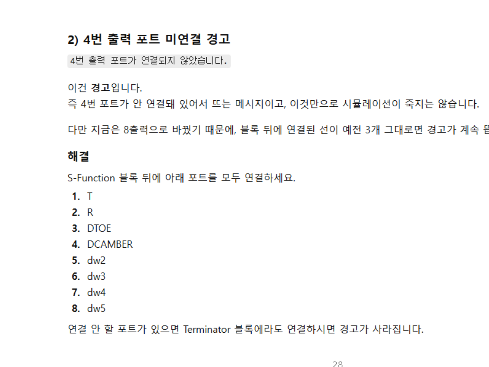

## 6-2. 검증 절차 및 테스트 시나리오

### Solver / 통신 설정

| 항목 | 설정 |
| --- | --- |
| Solver 유형 | Fixed-step (discrete) |
| Step size | 0.001 s (FSM_DT) |
| 권장 Stop time | 5 s 이상 |
| FMI2 DoStep | 0.001s의 정수배 스텝만 허용 |

### Scope 그룹 구성

| 그룹 | 신호 |
| --- | --- |
| ① 차량 운동 | T, R, ay (외부 bicycle model 안정성 우선 확인) |
| ② 서스펜션 응답 | dw2–dw5 (bounded 여부 확인) |
| ③ 얼라인먼트/기하 | DTOE, DCAMBER, ph1x, ph2z, ph3z |

### 단계적 시험 절차

- **테스트 A** — Step 4°, 100 km/h — T_ext/R_ext/ay_ext 정상 여부 → dw2–dw5 bounded 여부 순차 확인
- **테스트 B** — Step 2°, 100 km/h — 4°에서 과도 응답 시 2°로 축소 재확인
- **테스트 C** — Step/Ramp/Sine/Double-lane-change 등 임의 조향 프로파일 파형 시험

> 수렴 판정: 초기 응답 후 dw2·dw3가 빠르게 평형점에 수렴 / T·R은 정상상태에서 1e-9 수준 이하로 안정

---

# 7. 결론 및 향후 과제

- MATLAB S-Function 기반 서스펜션·조향 멀티바디 모델이 반복 검증을 거쳐 C 언어 1ms 고정 스텝 코어(fsm_step)로 성공적으로 이식됨
- 핵심 수치 안정성 이슈(B/Aeq 초기화, T/R 드리프트, 롤 응답 과다)는 매뉴얼 상 모두 해결 완료로 확인됨
- FMI 2.0 fmi2CoSimulation 래퍼로 패키징되어 5개 입력·35개 출력을 표준 VR 인터페이스로 노출, Hills 등 외부 환경과 연동 가능
- DoStep은 1ms 배수 스텝만 허용하며, 상태 직렬화(FMUstate)·방향도함수 등 고급 기능은 현재 범위에서 제외됨

### 향후 과제

- 실차/목표 파형 대비 정량적 튜닝(Kt, Ct, roll_wn/zeta/gain) 최종 확정
- FMU 상태 직렬화(GetFMUstate) 지원 검토
- Model Exchange 타입 확장 여부 검토
- Hills 환경 내 통합 co-simulation 회귀 테스트
